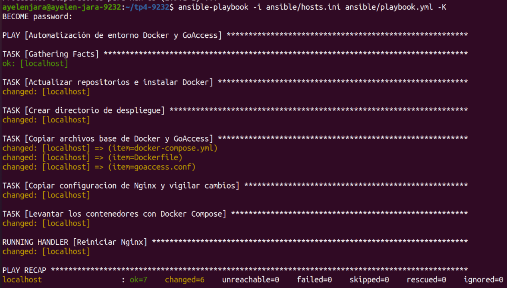
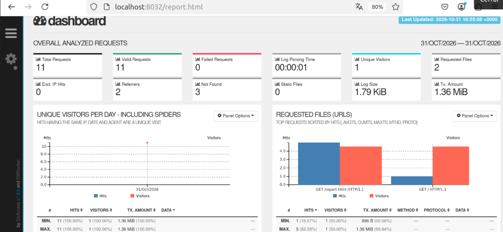
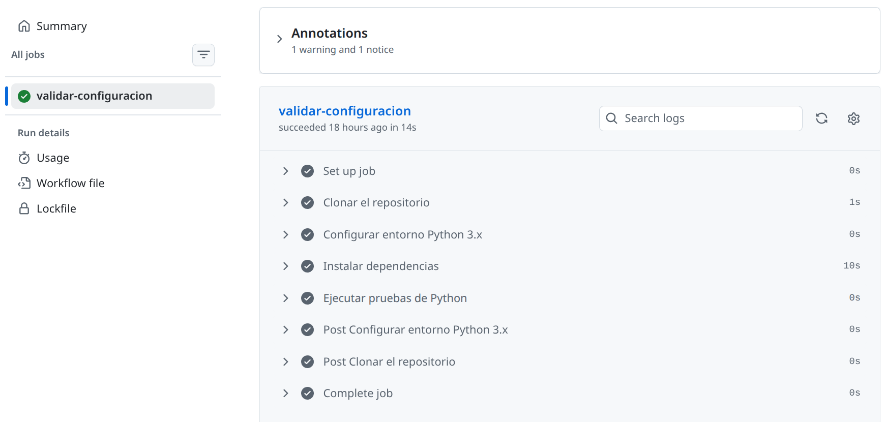

# Trabajo Práctico N° 4 - Automatización Avanzada (Contenedores, Ansible y CI/CD)

**Carrera:** Tecnicatura Universitaria en Administración de Sistemas y Software Libre

**Asignatura:** Automatización y Scripting

**Alumna:** Ayelen Jara

**Legajo N°:** 9232

## Descripción
El presente repositorio contiene la resolución del Trabajo Práctico N° 4 de la asignatura Automatización y Scripting. El mismo se enfoca en la implementación de configuraciones modernas de infraestructura, empaquetando aplicaciones en contenedores ligeros mediante Docker y orquestando múltiples servicios interconectados con Docker Compose. Además, aborda la instalación y configuración automática de los servidores utilizando Ansible, y culmina con la creación de un flujo de integración continua (CI) mediante GitHub Actions para la validación automática del código de despliegue.

## Tarea 1: Contenedores y Orquestación (Docker & Docker Compose)
Se implementó un entorno contenerizado para el análisis de tráfico web centralizado.
* **Dockerfile:** Se construyó una imagen personalizada basada en Alpine Linux para el servicio GoAccess. Se configuró un usuario y grupo sin privilegios para la ejecución segura del proceso, definiendo rutas específicas para la lectura de logs y escritura del reporte HTML.
* **Docker Compose:** Se orquestó la infraestructura mediante `docker/docker-compose.yml`, definiendo dos servicios interconectados: un servidor web Nginx expuesto en el puerto 8032 y un analizador de logs GoAccess expuesto en el puerto 9032. Se establecieron volúmenes compartidos para permitir que GoAccess consuma los registros de Nginx en tiempo real y devuelva el documento HTML generado para ser servido por el servidor web.

## Tarea 2: Gestión de Configuración Automática con Ansible
La orquestación de la infraestructura y el levantamiento de los servicios se automatizó mediante Ansible de forma declarativa.
* **Inventario:** Se definió el archivo `ansible/hosts.ini` apuntando a `localhost` y configurando variables para la conexión local y la elevación de privilegios (`become: yes`).
* **Playbook:** Se desarrolló `ansible/playbook.yml` para automatizar la instalación de las dependencias de Docker, la creación de los directorios de despliegue, la transferencia de los archivos base (`docker-compose.yml`, `Dockerfile`, `goaccess.conf`, `nginx.conf`) y el levantamiento automático de los contenedores. Se implementó una acción automática para reiniciar el servicio Nginx ante cualquier modificación en su configuración.

### Monitoreo de Servicios (GoAccess)
Como resultado del despliegue, el contenedor dedicado a GoAccess procesa exitosamente las métricas de tráfico generadas por Nginx. El servicio lee los registros en tiempo real y expone la información analizada a través de un dashboard HTML interactivo servido en el puerto definido.

## Tarea 3: Integración Continua (CI/CD) con GitHub Actions
Se configuró un pipeline de integración continua para asegurar que los cambios estructurales sean testeados automáticamente.
* **Script de Pruebas:** Se programó el script `tests/test_config.py` en Python, utilizando `unittest` y `yaml` para ubicar el archivo `docker-compose.yml` y validar estrictamente su sintaxis antes de un posible despliegue.
* **Pipeline CI:** Se implementó el flujo de trabajo en `.github/workflows/ci-pipeline.yml`. Ante cada evento `push` sobre la rama `main`, el sistema levanta un entorno virtual basado en Ubuntu (`ubuntu-latest`), clona el repositorio, configura Python 3.x, instala dependencias e inicializa el entorno de pruebas.

El sistema completó todos los pasos sin errores, confirmando la validez de la sintaxis del archivo y garantizando que el entorno de contenedores está listo para un despliegue seguro.

